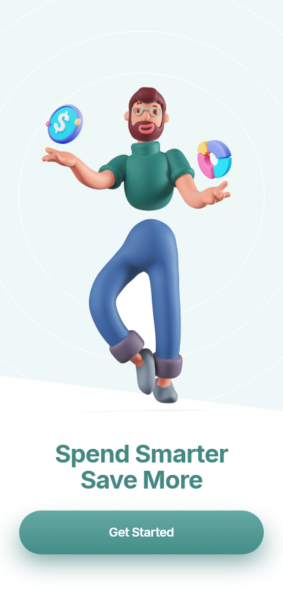
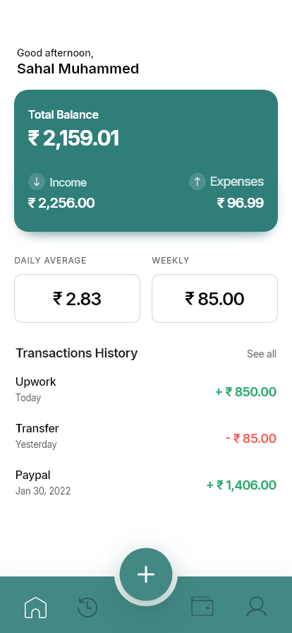
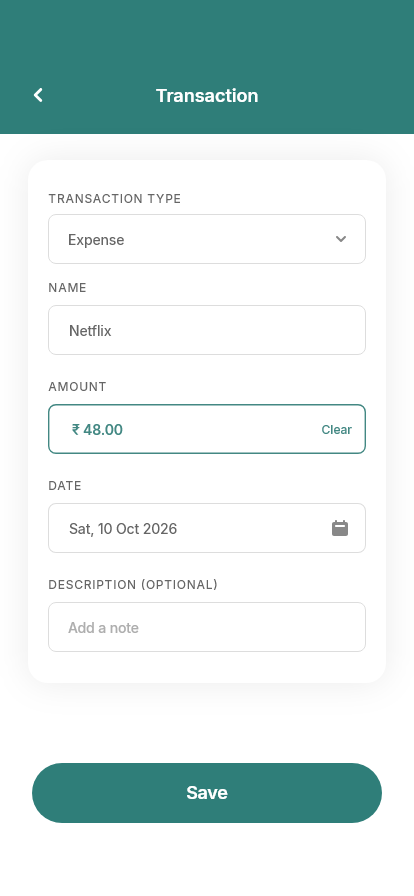
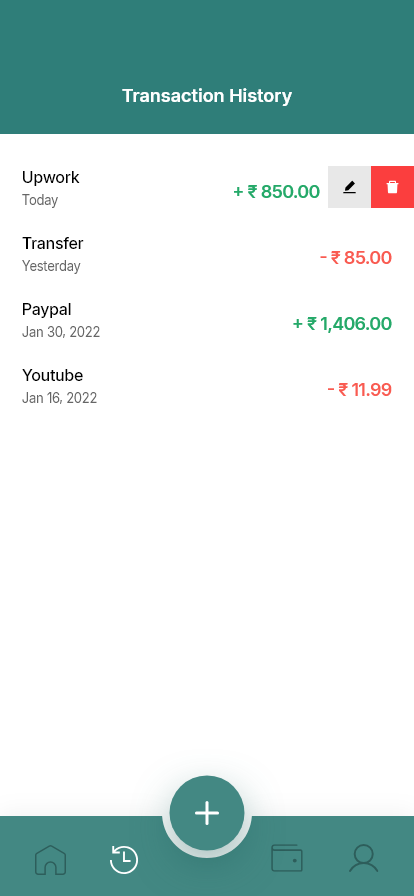
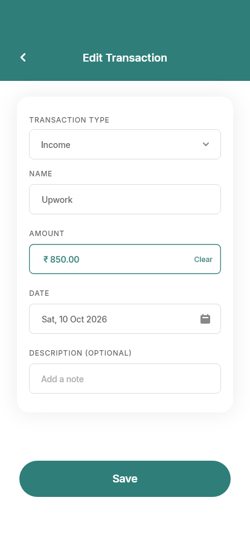
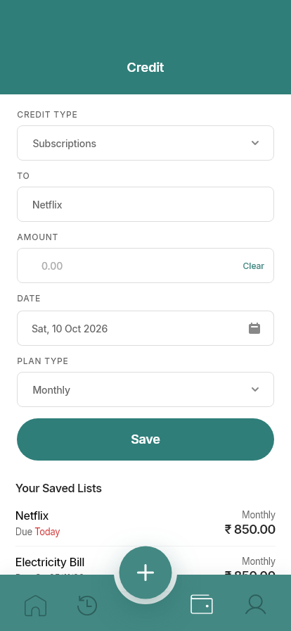
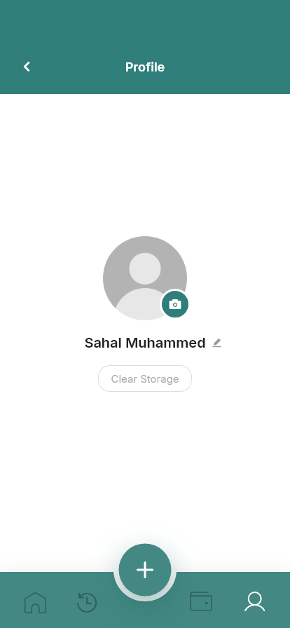

# Expenzia – Expense Management App

Expenzia is a Flutter expense management application that reproduces eight screens from a supplied Figma design and stores expenses in a local **SQLite** database with full create, read, update, and delete (CRUD) support.

| Splash | Onboarding | Home | Transaction |
|---|---|---|---|
|  |  |  |  |
| **Transaction History** | **Edit Transaction** | **Credit** | **Profile** |
|  |  |  |  |

> These are **not** captures from a phone. They are rendered by `test/screenshots_test.dart` in the Flutter test environment at the Figma frame size (414 × 896), using the real widgets and a real SQLite database.
>
> The rows shown are test fixtures copied from the Figma example content; the app itself starts with an empty database and never inserts sample data.
>
> - `design/` – reference PNGs exported from the Figma frames.
> - `screenshots/app/` – regenerate with `flutter test test/screenshots_test.dart --dart-define=UPDATE_SCREENSHOTS=true` (a normal `flutter test` run does not overwrite them).
> - `screenshots/compare/` – side-by-side images (left: Figma, right: app). They were composed once with a small image script that is not part of this repository, so they are not regenerated by the tests.

## Features

- **Expenses (SQLite CRUD):** add, list, edit and delete transactions. Each record has a title, amount, category (Expense / Income – the Figma "Transaction Type" dropdown), date and optional description.
- **Delete confirmation:** dialog before anything is removed.
- **Live totals:** Total balance, income, expenses, daily average (last 30 days ÷ 30) and weekly spend (last 7 days) are recalculated after every change.
- **Empty states:** on Home, Transaction History and the Credit list.
- **Validation:** name required (max 50 chars), amount must be a positive number with at most two decimals (max ₹1 crore), description max 200 chars.
- **Error handling:** database errors are converted to readable messages (`RepositoryException`) and shown in a SnackBar or on screen; the app does not crash.
- **Persistence:** data is loaded from SQLite while the splash screen is visible and survives closing and reopening the app.
- **Indian Rupee formatting:** Indian digit grouping (`₹ 1,00,000.00`).
- **Credit screen:** saves subscriptions / loans / bills to SQLite and lists them with due dates ("Due Today" in red). Long-press a saved item to delete it.
- **Profile:** editable name, and **Clear Storage** (with confirmation) to wipe all data. Onboarding is shown on first launch only.

## How to use

- **Add:** tap the raised **+** button in the bottom bar.
- **Edit / delete:** open **Transaction History** (clock icon), then swipe a row to the left (or tap it) to show the grey edit and red delete buttons.
- **See all:** on Home opens Transaction History.

## Project structure

```text
lib/
  main.dart                  App entry; creates database, repositories, controllers
  app_scope.dart             InheritedWidget giving screens access to controllers
  core/
    constants/app_assets.dart
    theme/                   app_colors, app_text_styles, app_theme (Figma tokens)
    utils/                   formatters (₹, dates), validators
  models/                    expense, expense_summary, credit
  database/                  app_database (schema), expense/credit/settings queries
  repositories/              expense/credit/profile repositories + RepositoryException
  controllers/               ChangeNotifier classes that reload data after changes
  screens/                   splash, onboarding, main_shell, home, history,
                             transaction_form (add + edit), credit, profile
  widgets/                   header, primary button, form fields, transaction rows,
                             swipe actions, bottom nav, empty state, dialogs, shadow
```

Data flow: **Screen → Controller → Repository → Database (sqflite)**. The UI never runs SQL directly.

## Design fidelity

Colours, font sizes, weights, letter spacing, radii, borders, shadows and positions come from the Figma file (read through the Figma MCP API). Icons, the onboarding background and the splash texture are the original Figma exports in `assets/`. The font is **Inter** (bundled, OFL licence).

Measured against the Figma frames at 414 × 896:

- Form labels and boxes land on the exact Figma coordinates (e.g. labels at y = 191 / 280 / 379 / 478, 50 px boxes).
- Onboarding illustration region: mean pixel difference 0–0.8 / 255.
- Card, button and bottom-bar shadows sampled within a few colour levels.

Known differences, on purpose or because data was not available:

| Area | Difference | Reason |
|---|---|---|
| Transaction form | Extra **Description (optional)** field below Date | Required by the brief; not in Figma |
| Credit form | Extra **Amount** field | The saved list shows amounts but the Figma form has no amount input |
| Currency | `₹` everywhere (Figma Home uses `$`) | Decided: Indian Rupee |
| Status bar | Real device status bar instead of the drawn 9:41 bar | System UI |
| Onboarding coin/donut | Cropped from the 1× Figma render | Figma API rate limit blocked separate exports; may look soft on high-density screens |
| Get Started button | Gradient and shadow sampled from the render | Exact layer properties could not be read (rate limit) |
| History list | Uniform 66 px row spacing | Figma's first two rows are 59 px apart (swiped-row mock-up) |
| Camera badge on Profile | Decorative only | Photo upload is not part of the brief |

## Running

```bash
flutter pub get
flutter run                 # on an Android device or emulator
flutter test                # unit, database, end-to-end and screenshot tests
flutter build apk --release  # see "Signing" below
```

## Build and verification status

Built and tested with Flutter 3.41.8 (Dart 3.11) on Windows.

| Check | Status |
|---|---|
| `flutter analyze` | No issues |
| `flutter test` (23 tests) | All pass |
| Android `flutter build apk --release` | Builds successfully |
| Run on a physical device or emulator | **Not done yet** – no device or emulator was available. App behaviour has only been verified by the automated widget tests above. |
| iOS build | **Not built** – requires macOS and Xcode. The iOS project is the standard Flutter scaffold and `sqflite` supports iOS, but this is untested. |
| Web, Windows, Linux, macOS | **Not supported.** The platform folders are the standard Flutter scaffolding and are kept, but `sqflite` does not run on web, and desktop would need `sqflite_common_ffi` initialisation (only used in tests). |

### Signing

The release APK is **debug-signed and is not production-release signed**. `android/app/build.gradle.kts` still uses the Flutter template settings: the application ID is `com.example.expenzia` and the `release` build type uses the debug signing config. This is fine for installing and reviewing the app, but the APK cannot be published to the Play Store without a real application ID and release keystore.

## Tests

`flutter test` runs 23 tests:

- `test/unit_test.dart` – rupee formatting, relative dates, validators, summary maths.
- `test/database_test.dart` – CRUD on a real SQLite file, ordering, persistence after closing/reopening, database errors → `RepositoryException`, credits and settings.
- `test/app_flow_test.dart` – full UI flow: splash → onboarding → empty state → validation errors → add expense and income → totals → edit → delete (cancel, then confirm) → app restart keeps data; credit save; Clear Storage.
- `test/screenshots_test.dart` – renders all 8 screens with fixture data and fails on layout errors; writes the PNGs to `screenshots/app/` only when run with `--dart-define=UPDATE_SCREENSHOTS=true`.

Database tests use `sqflite_common_ffi`, so the real SQLite engine runs on the development machine.